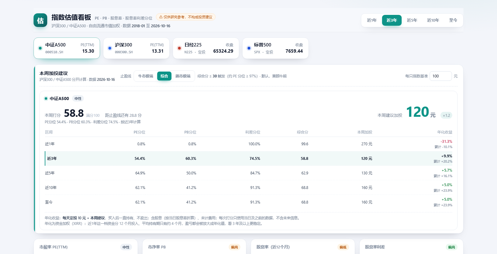

# 指数估值看板 · 沪深300 / 中证A500

一个本地即可运行的静态网页看板：按**自由流通市值加权**计算两个指数的
市盈率 PE(TTM)、市净率 PB、股息率，以及「股息率 − 10 年期国债收益率」利差，
并给出**每周加投建议**与**止盈线**。



## 快速开始

直接双击 **`启动看板.bat`**（等价于用浏览器打开 `web/index.html`），无需安装依赖、无需联网。

可选本地服务：

```bash
python -m http.server 8765 --directory web
```

## 自动更新（GitHub Actions + Pages）

仓库自带两个 workflow，每个交易日收盘后自动更新线上数据：

| 文件 | 作用 |
| --- | --- |
| `.github/workflows/update.yml` | 每天 **UTC 13:00（北京 21:00）** 抓数 → 体检 → 发布到 `gh-pages` 分支 |
| `.github/workflows/probe.yml` | 手动触发，测试 GitHub 的 runner 能否访问中证指数与东方财富（换网络环境时先跑它） |

**首次部署（一次性）**

1. 在 GitHub 新建**公开**仓库，把本目录推上去：
   ```bash
   git init && git add -A && git commit -m "init"
   git remote add origin https://github.com/<你的用户名>/<仓库名>.git
   git push -u origin main
   ```
2. 仓库 **Settings → Pages → Source** 选 **Deploy from a branch**，分支选 `gh-pages`、目录 `/ (root)`。
3. 到 **Actions** 页手动跑一次 `每日更新估值并按 gh-pages 发布`，等它变绿。
4. 访问 `https://<你的用户名>.github.io/<仓库名>/`。

之后每个交易日 21:00 自动更新，页面刷新即最新。仓库里的 `web/data/app-data.js` 只是快照，
线上数据以 `gh-pages` 分支为准。

**健康检查**：每次发布前跑 `scripts/check_data.py`，校验交易日数量、最新日期是否够新、
PE/PB/股息率是否在合理区间、两个指数日期是否一致。任一不过 → **不发布**，线上保留上一次的可用版本。

**注意**：GitHub 的 runner 在境外，若某天访问不了东财/中证，这一步会失败但不会污染线上数据；
此时改用本地定时任务跑 `python scripts/fetch_data.py` 后手动 `git push` 即可（或参考 `.bat`）。

## 功能

- **本周加投建议**：跟随顶部选中的指数（默认中证A500，其次沪深300），给出综合分、加投金额、
  以及「距止盈线还有 X 分」；表格按 近1年 / 3年 / 5年 / 10年 / 至今 **分别算分**，跟随区间切换高亮。
- **止盈线**：三档（牛市极端 10 / 综合 30 / 熊市极端 45）。切换档位只改变触发线，
  不改变分数本身；分数 ≤ 阈值时按 0 计、当周不加投，表格里低于该线的区间会灰显。
- **年化收益（回测）**：按「每天定投 10 元 + 每周按建议加投」逐日模拟到最新交易日，
  给出每个区间各自的资金加权年化（XIRR）与累计收益。**打分只用当日及之前的数据**，
  不存在未来函数；持有期间不卖出。
- **基准金额可调**：每只指数一个基准（默认 100 元），存浏览器本地。
- **指标卡**：PE、PB、股息率、股息率利差，含当前值、区间分位、均值、区间高低点。
- **主图**：PE / PB / 股息率 / 利差四个标签页，左轴指标、右轴指数点位，叠加区间
  20% / 50% / 80% 分位参考线；鼠标悬停显示当日数值、指数点位，以及**该点在当前区间内的分位**
  （切到近1年就按1年算，切到近5年就按5年算）。
- **日 K 线**：日线蜡烛图 + MA20 / MA60 + 成交额，红涨绿跌，支持滚轮缩放。
- **股息率 vs 10 年期国债**：上两条利率曲线，下为利差面积。
- **利差历史分位** + **利差分布直方图**。
- **可分享视图**：`web/index.html#000510.SH/10/pb/mid`（指数/区间/指标/止盈档）。
- **海外市场 · 定投年化**：最后两个标签页（日经225、标普500），只有一张价格走势图 +
  **年 / 月 / 日 六个输入框**（年、月、日分开填，填完年自动跳到月；月或日留空则按区间首末补齐），
  下方给出该区间「每个交易日定额定投」的年化收益（XIRR）与累计收益，并对照同期一次性买入。
  数据：日经225 来自 FRED（1949-05 起），标普500 来自 Yahoo Finance（1970-01 起），均为价格指数、不含股息。
  地址形如 `#N225/1989-12-29/2026-10-16`、`#SPX/2000-01-01/2026-10-16`。

## 指标口径（自由流通市值加权）

```
w_i(t) = 自由流通市值_i(t) / Σ 自由流通市值_j(t)

PE(TTM)(t) = Σ 自由流通市值_i(t) / Σ 净利润_i(t)      # 亏损股的负净利润计入分母
PB(t)      = Σ 自由流通市值_i(t) / Σ 净资产_i(t)
股息率(t)   = Σ [ w_i(t) × 个股股息率_i(t) ]
```

- **个股股息率**：预案口径——分红方案一经公告即计入，同一财报期只取最新一期（避免中期分红跨年重复）。
- **分位**：区间内「小于等于当前值」的交易日占比（0% 最低、100% 最高）。
- **综合分** = `0.3 × (100 − PE分位) + 0.2 × (100 − PB分位) + 0.5 × 利差分位`，0 最贵、100 最便宜。
  PE 抓盈利（波动大但有弹性），PB 抓账面价值（稳，擅长在“贵”的一端报警），利差抓股债性价比，三者互补。

## 加投与止盈规则

综合分 `S = 0.3 × (100 − 近N年PE分位) + 0.2 × (100 − 近N年PB分位) + 0.5 × 近N年股息率利差分位`
（N 跟随右上角区间）。

**金额是连续映射**，不再分 7 档：按 S 在下列锚点间线性插值得到倍数，再乘基准并按 **10 元取整**。

| 锚点 S | 0 | 22.5 | 37.5 | 52.5 | 67.5 | 80 | 92 | 100 |
| --- | --- | --- | --- | --- | --- | --- | --- | --- |
| 倍数 | 0.30 | 0.40 | 0.60 | 1.00 | 1.50 | 2.00 | 2.50 | 2.70 |

基准 100 元时的大致对照：

| S | 10 | 20 | 30 | 40 | 50 | 60 | 70 | 80 | 90 | 100 |
| --- | --- | --- | --- | --- | --- | --- | --- | --- | --- | --- |
| 金额 | 30 | 40 | 50 | 60 | 90 | 130 | 160 | 200 | 240 | 270 |

好处是金额随分数平滑变化（相邻两周通常只差 10~20 元），不会在 100/150 之间来回跳。

止盈线（S ≤ 阈值 → 分数按 0 计、不加投）：

| 档位 | 阈值 | 约等于 PE 分位 | 含义 |
| --- | --- | --- | --- |
| 牛市极端 | ≤ 10 | ≥ 99% | 只在泡沫级估值才停手 |
| **综合（默认）** | **≤ 30** | **≥ 97%** | 兼顾牛熊 |
| 熊市极端 | ≤ 45 | ≥ 94% | 弱市里更早停手 |

> 阈值来自 2019-08 以来滚动窗口（3 年窗口、按季滑动）的实测：
> 全样本中 S ≤ 30 的交易日，之后 12 个月平均 −9.3%（沪深300）/ −4.7%（中证A500）、胜率 32~42%；
> 牛市主导窗口的“最贵 10%”约 S ≈ 7，熊市主导窗口约 S ≈ 45–56。
> 加入 PB 后重新验证过，阈值 10 / 30 / 45 对应的“贵”程度基本不变，故未调整。
> 表格中低于当前止盈线的区间会**灰显并标注「止盈线以下」**，表示该档在当前设定下不会产生金额。
> 样本仅一个周期，不构成投资建议。

## 年化收益是怎么回测的

卡片底部每一行都有一个「年化收益」，口径固定为：

```
每个交易日：买入 10 元
每周第一个交易日：按当周综合分算出加投金额，一并买入
持有到最新交易日：从不卖出
```

- **无未来函数**：第 t 天算分只用 `[t−N年, t]` 的数据，分位窗口随日期滚动；
  绝不会用到 t 之后的行情或财报。
- **收益口径**：用「价格涨跌 + 当日股息率/365」合成全收益序列，相当于股息再投资；未计费用与税费。
- **年化用 XIRR**（资金加权内部收益率），因为每周投入的金额不同。
  表格里同时给出「累计」，因为短窗口的年化会被放大：
  近1年档资金分 12 个月投入、平均持有期只有约 4 个月，
  累计 −10% 年化后会显示成 −31%，这是正常的数学放大，不是 bug。

## 数据来源

| 数据 | 来源 | 说明 |
| --- | --- | --- |
| 成分股名单 | [中证指数官网](https://www.csindex.com.cn) `cons.xls` | 最新一期，300 / 500 只 |
| 指数日 K（开高低收、成交额） | 中证指数官网 `index-perf` | 日频 |
| 个股 PE(TTM)、PB、自由流通市值、收盘价 | [东方财富·估值分析](https://data.eastmoney.com/gzfx/) | 每只一次请求，2018-01 起日频 |
| 个股分红送配（含预案公告日、财报期） | 东方财富 `RPT_SHAREBONUS_DET` | 还原预案口径股息率 |
| 中国 10 年期国债收益率 | [东方财富·中美国债收益率](https://data.eastmoney.com/cjsj/zmgzsyl.html) | 日频，1990 年至今 |

全部免费公开、无需 key；抓取脚本只用 Python 标准库（`xls` 解析用仓库内 `scripts/vendor/xlrd`）。

## 更新数据

```bash
python scripts/fetch_data.py
```

四个步骤（约 2~3 分钟，需联网）：成分股名单 → 563 只个股日频估值 → 全市场分红 → 聚合并写入
`web/data/app-data.js`。

## 目录结构

```
jinrong/
├─ 启动看板.bat / 更新数据.bat
├─ web/{index.html, styles.css, app.js, vendor/echarts.min.js, data/app-data.js}
├─ scripts/{fetch_data.py, fetch_constituents.py, fetch_stocks.py,
│           fetch_dividends.py, build_data.py, get_echarts.py, vendor/xlrd/}
├─ data/{constituents.json, raw/…}
└─ preview.png
```

## 说明与限制

- **历史自 2018-01 开始**：免费个股估值接口只提供 2018 年以来的日频数据，「近10年」与「至今」实际都从 2018-01 起算（约 8.7 年）。
- **成分股按最新一期名单回溯**：未还原历史调仓；中证A500 于 2024-09-23 发布，之前为编制方回溯点位。
- 短区间（近1年）分位波动大，容易给出“极端便宜/贵”的信号，建议以 3 年为主、5 年为辅。
- 本页面仅用于数据展示与研究，不构成任何投资建议。
